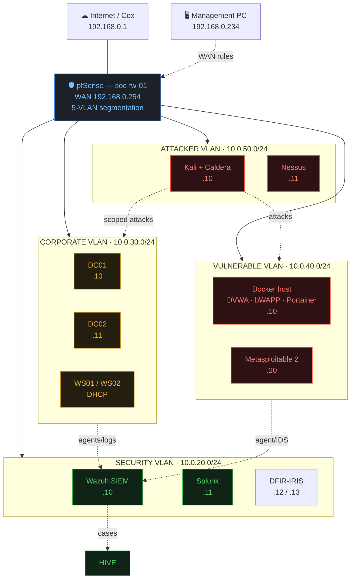

# Home SOC & Blue Team Lab
 
A fully segmented, home-built security operations lab for practicing **detection engineering and purple-team work** — attacking intentionally vulnerable systems, then proving the attacks are caught with host and network telemetry. Built on Proxmox with free and open-source tooling ($0 budget), modeled after a production enterprise network.

---

## Network Architecture

**Live purple-team detection flow:**

**Network Diagram**

The lab is segmented into five VLANs behind a pfSense firewall, each with its own ruleset enforcing least-privilege access. An attack launched from the ATTACKER VLAN is blocked at the perimeter, fires a detection in the SECURITY (SOC) zone, and is escalated to a case in DFIR-IRIS — the full detect-and-respond pipeline.
 
---

## What This Demonstrates
 
- **Network segmentation** — five isolated VLANs, default-deny rulesets, verified traffic boundaries
- **Detection engineering** — custom SIEM rules and decoders, alert tuning, signal-vs-noise triage
- **Purple teaming** — real attack techniques run against the lab, each mapped to a detection
- **SOC operations** — SIEM, IDS, case management, and endpoint telemetry working as one pipeline
- **Infrastructure** — hypervisor management, Active Directory, Docker, reproducible builds that survive reboots

---
 
## Tech Stack
 
| Layer | Tools |
|---|---|
| Hypervisor | Proxmox VE |
| Firewall / IDS | pfSense, Suricata |
| SIEM | Wazuh, Splunk |
| Case management | DFIR-IRIS |
| Endpoint telemetry | Sysmon (sysmon-modular), Wazuh agents |
| Directory services | Windows Server 2025 Active Directory |
| Attack infrastructure | Kali Linux, MITRE Caldera, Nessus Essentials |
| Vulnerable targets | DVWA, bWAPP, Metasploitable 2 |
 
---

## Detection Results
 
Each scenario runs a real attack technique, then verifies the detection. Full write-ups with evidence are linked below.
 
| # | Scenario | MITRE ATT&CK | Detection source | Status |
|---|---|---|---|---|
| 01 | Kerberoasting | T1558.003 | Windows 4769 (RC4) + custom Wazuh rule | ⬜ Planned |
| 02 | AS-REP Roasting | T1558.004 | Windows 4768 (pre-auth 0) | ⬜ Planned |
| 03 | Web attacks (SQLi / XSS / cmd injection) | T1190 | Suricata + Wazuh | ⬜ Planned |
 
<!-- Update Status to ✅ Detected and add a "Time to detect" column as each scenario completes -->
 
---

## Build Phases
 
| Phase | Focus | Status |
|---|---|---|
| 1 | Network infrastructure (pfSense, VLANs, segmentation) | ✅ Complete |
| 2 | Security monitoring (Wazuh, Splunk, DFIR-IRIS) | ✅ Complete |
| 3 | Active Directory (DCs, GPOs, Sysmon, agents) | ✅ Complete |
| 4 | Vulnerable systems (DVWA, bWAPP, Metasploitable, Suricata) | ✅ Complete |
| 5 | Attack infrastructure (Kali, Caldera, Nessus) | ✅ Complete |
| 6 | Detection engineering / purple team | 🔄 In progress |
| 7 | Documentation & portfolio | 🔄 In progress |
 
Condensed build details: [docs/02-build-log.md](docs/02-build-log.md)
 
---

## Repository Guide
 
| Path | Contents |
|---|---|
| [docs/01-architecture.md](docs/01-architecture.md) | Network design, VLAN rationale, full tool stack |
| [docs/02-build-log.md](docs/02-build-log.md) | Condensed Phase 1-5 build summary |
| [docs/troubleshooting.md](docs/troubleshooting.md) | Problems hit during the build, root causes, and fixes |
| [scenarios/](scenarios/) | Per-attack write-ups: attack steps, detection, evidence, remediation |
| [detections/](detections/) | Custom Wazuh rules and decoders, Sigma rules |
| [firewall-rules/](firewall-rules/) | pfSense rulesets as copy-paste reference tables |
 
---

## Key Design Decisions
 
A few deliberate choices that reflect production trade-offs:
 
- **Password policy follows NIST 800-63B** — long passwords, no forced periodic rotation.
- **Separate named admin account** instead of daily use of the built-in Administrator.
- **Intentionally vulnerable service accounts** (Kerberoastable, AS-REP roastable) to exercise detections — in production these would be gMSAs.
- **Default-deny VLAN segmentation** — internet access granted to one host, temporarily, then revoked (least privilege).
- **Vulnerable hosts keep default credentials on purpose** — risk is controlled by segmentation, not host hardening.
- **Host and network telemetry are complementary** — a legacy host with no agent is still visible via the network IDS.
---

## About
 
Built as a hands-on portfolio project for SOC / blue-team work. The goal is not just a running lab, but a documented record of building detections, validating them against real attacks, and reasoning about the trade-offs — the daily work of a security analyst.

