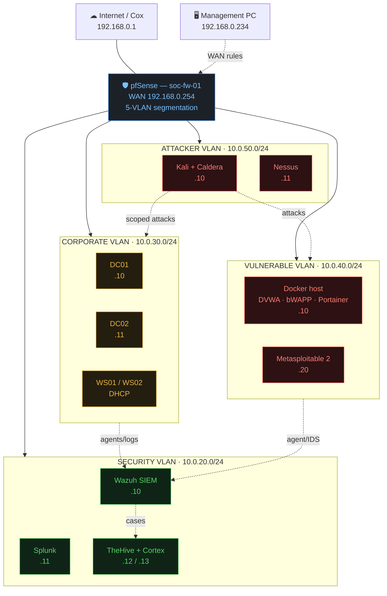

# Architecture

Full network design, VLAN rationale, and tool stack for the home SOC lab.

---

## Topology

---

## Host

| Item | Value |
|---|---|
| Hypervisor | Proxmox VE |
| Hardware | HP Elite Mini 600 G9 — 14 cores / 20 threads |
| RAM | 32 GB (upgrade to 64 GB planned) |
| Primary VM storage | 4 TB SATA SSD (qcow2, snapshots enabled) |

---

## Network Segmentation

Five VLANs behind a pfSense firewall. Each VLAN has its own ruleset; the default posture is deny, with explicit passes per service.

| VLAN | Subnet | Purpose | Posture |
|---|---|---|---|
| SECURITY | 10.0.20.0/24 | SOC tooling (Wazuh, Splunk, TheHive, Cortex) | Default pass (trusted) |
| CORPORATE | 10.0.30.0/24 | Active Directory, workstations | DNS/agents/internet only |
| VULNERABLE | 10.0.40.0/24 | DVWA, bWAPP, Metasploitable | Default-deny, no internet |
| ATTACKER | 10.0.50.0/24 | Kali, Nessus | VULNERABLE + internet only |
| Management | 192.168.0.0/24 | Home network / admin PC | pfSense WAN |

Full rulesets: [../firewall-rules/](../firewall-rules/)

---

## Why It's Built This Way

- **Segmentation first** — every VLAN is isolated by default, so an attacker in one segment can't trivially reach another. This is what the detections are tested against.
- **Separate attack and target networks** — mirrors a real engagement where the red team operates from dedicated infrastructure.
- **Host + network telemetry** — endpoint agents (Wazuh/Sysmon) and a network IDS (Suricata) are deployed together, because each sees what the other misses.

---

## Tool Stack

| Function | Tool |
|---|---|
| Hypervisor | Proxmox VE |
| Firewall / router | pfSense |
| Network IDS | Suricata (ET Open ruleset) |
| SIEM | Wazuh (manager + indexer + dashboard) |
| Log platform | Splunk |
| Case management | TheHive + Cortex |
| Endpoint telemetry | Sysmon (sysmon-modular), Wazuh agents |
| Directory services | Windows Server 2025 AD |
| Attack platform | Kali Linux, MITRE Caldera |
| Vulnerability scanner | Nessus Essentials |
| Vulnerable targets | DVWA, bWAPP, Metasploitable 2 |
